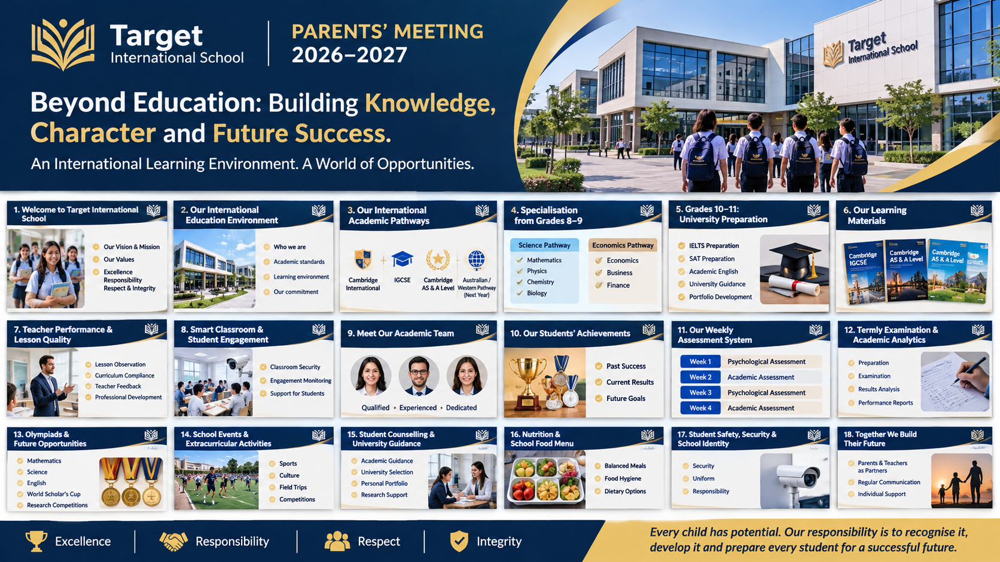

# Target International School Parents' Meeting

For the Target International School Parents' Meeting, I recommend
creating **one unified, professional PowerPoint presentation** for all
homeroom teachers and tutors to use.

The presentation should not look like a collection of separate teachers'
slides. It should tell one powerful story:

**Who we are → How we educate → How we monitor progress → What our
students achieve → What opportunities we offer → What future we are
building together.**

The main purpose is to make parents feel three things:

1.  Their children are receiving a high-quality international education.
2.  Every student's academic development, behaviour and wellbeing are
    monitored.
3.  Target International School has a clear pathway for each student's
    future.

# Target International School

**PARENTS' MEETING 2026--2027**

*Suggested cover image: modern international school campus, students and
teachers collaborating, and contemporary school architecture.*

**Visual overview**

*This is a visual concept overview for the presentation, not 18 separate editable slide images. Replace illustrative details with verified school information and approved school photographs before presenting.*

**Suggested presentation title:**

*Beyond Education: Building Knowledge, Character and Future Success.*

Subtitle: *An International Learning Environment. A World of
Opportunities.*

## Recommended PowerPoint structure

I recommend **18 slides**, divided into six sections. Each class teacher
should use the same template, design and order, while adding their own
class information.

### Section 1. Introduction --- Who We Are

#### Slide 1. Welcome to Target International School

-   School name and logo
-   Our educational vision and mission
-   Our values: Excellence, Responsibility, Respect and Integrity
-   Welcome message from the school leadership

*Suggested image: international school students in a diverse, modern
classroom.*

#### Slide 2. Our International Education Environment

-   Who we are
-   Our academic standards
-   Our learning environment
-   Our commitment to students and families

*Suggested image: modern international school campus and classrooms.*

### Section 2. Academic System --- How We Educate

#### Slide 3. Our International Academic Pathways

Present the educational systems clearly:

-   Cambridge International
-   IGCSE
-   Cambridge International AS & A Level
-   Planned introduction of an Australian/Western education pathway next
    academic year.

*Suggested image: Cambridge international education, students studying
in a classroom.*

#### Slide 4. Specialisation from Grades 8--9

Students are guided towards two academic directions:

-   **Science pathway:** Mathematics, Physics, Chemistry, Biology and
    related subjects.
-   **Economics pathway:** Economics, Business, Finance and related
    subjects.

Explain how students' interests and future university goals inform their
direction.

*Suggested image: high school science laboratory and students conducting
experiments.*

#### Slide 5. Grades 10--11: University Preparation

-   IELTS preparation
-   SAT preparation
-   Academic English
-   University application guidance
-   Portfolio and research development
-   Structured university-preparation programme

Explain the specific university-preparation system used by the school.

*Suggested image: high school students preparing for IELTS, SAT and
university admission.*

#### Slide 6. Our Learning Materials

Show actual book covers, not just book titles.

-   Cambridge-approved and curriculum-aligned materials
-   Cambridge textbooks
-   Hybrid programme textbooks
-   Supplementary learning resources
-   Digital learning platforms

Include the exact book titles used in each grade.

*Suggested image: Cambridge international textbooks and school books.*

### Section 3. Academic Quality & Monitoring

This section is particularly important because parents should understand
how the school checks teaching quality and student progress.

#### Slide 7. Teacher Performance & Lesson Quality

Explain the classroom monitoring system:

-   Classroom audio-recording technology, where implemented.
-   Lesson observation and evaluation.
-   Syllabus and curriculum compliance.
-   Use of appropriate teaching materials.
-   Teacher performance feedback and professional development.

Show how the academic team supports continuous improvement.

*Suggested image: teacher delivering a lesson using classroom
technology.*

#### Slide 8. Smart Classroom & Student Engagement

-   Classroom security cameras.
-   Student participation monitoring.
-   Classroom engagement and learning behaviour.
-   Identification of students who need additional support.
-   Responsible use of AI-assisted classroom analytics, if implemented.

Explain privacy, authorised access and data protection clearly. Do not
promise automated behaviour warnings unless the system actually provides
them.

*Suggested image: smart classroom, CCTV camera and educational
technology.*

#### Slide 9. Meet Our Academic Team

Each teacher's profile should include:

-   Professional photograph
-   Full name and subject
-   Academic qualification
-   Teaching experience
-   Professional certificates
-   Student achievements and academic contributions

Include the total number of teachers and their academic qualifications.

*Suggested image: professional group portrait of international school
teachers.*

### Section 4. Assessment, Achievements & Student Development

#### Slide 10. Our Students' Achievements

Divide into three parts:

-   **Past:** Previous competition results, certificates and awards.
-   **Present:** Current academic achievements and student progress.
-   **Future:** Upcoming competitions, Olympiads and international
    opportunities.

Include real student photographs, names, certificates and results, with
appropriate permission.

*Suggested image: students receiving academic achievement certificates.*

#### Slide 11. Our Weekly Assessment System

Show the four-week assessment cycle:

  Week     Assessment
  -------- --------------------------
  Week 1   Psychological assessment
  Week 2   Academic assessment
  Week 3   Psychological assessment
  Week 4   Academic assessment

Explain that results help identify strengths, learning gaps and
individual support needs.

*Suggested image: students taking a weekly school assessment.*

#### Slide 12. Termly Examination & Academic Analytics

-   Termly examination preparation.
-   Subject teachers prepare students and conduct examinations.
-   Examination papers and results are submitted to the Cambridge Exam
    Officer.
-   Results are securely recorded and analysed.
-   Individual and class performance reports are prepared.

**Suggested timeline:** 20th--30th of the relevant examination month,
according to the approved school calendar.

*Suggested image: teacher grading examination papers.*

#### Slide 13. Olympiads & Future Opportunities

Present the competitions students can participate in:

-   Mathematics Olympiads
-   Science Olympiads
-   English language competitions
-   World Scholar's Cup
-   International academic challenges
-   Research and project competitions

Show planned participation dates and preparation opportunities.

*Suggested image: students participating in mathematics and science
Olympiads.*

### Section 5. School Life & Student Welfare

#### Slide 14. School Events & Extracurricular Activities

-   Events we have successfully completed.
-   Recent school activities.
-   Upcoming celebrations and competitions.
-   Open lessons, exhibitions, field trips and cultural events.
-   Sports and creative activities.

*Suggested image: international school cultural day or sports day.*

#### Slide 15. Student Counselling & University Guidance

Particularly for Grades 10--11:

-   Student counselling and academic guidance.
-   University selection.
-   IELTS and SAT preparation guidance.
-   Personal portfolio development.
-   Research paper support.
-   University application preparation.

*Suggested image: school university or career counsellor advising a high
school student.*

#### Slide 16. Nutrition & School Food Menu

-   Daily food menu.
-   Breakfast, lunch and snacks, where provided.
-   Balanced and nutritious meals.
-   Food hygiene and quality standards.
-   Procedure for informing the school about dietary requirements.

*Suggested image: healthy, balanced school lunch.*

#### Slide 17. Student Safety, Security & School Identity

Divide the slide into three sections:

-   **Security:** Access control, visitor registration, CCTV and student
    safeguarding.
-   **Uniform:** Official Target-branded school clothing and dress code.
-   **Student responsibility:** Attendance, punctuality, discipline and
    respectful behaviour.

*Suggested image: school entrance, reception and security arrangements.*

### Section 6. Partnership & Closing

#### Slide 18. Together We Build Their Future

-   Parents and teachers as partners.
-   Regular communication with homeroom teachers and tutors.
-   Academic progress updates.
-   Individual student support.
-   Parent feedback and questions.

**Closing statement:**

*"Every child has potential. Our responsibility is to recognise it,
develop it and prepare every student for a successful future."*

*Suggested image: teacher speaking with parents at an international
school parent meeting.*

## How every homeroom teacher and tutor must prepare the presentation

The most important point: **all classes must follow one school-wide
presentation structure.** Teachers should not independently change the
order, design or academic information.

I recommend dividing the work into two parts.

### Part A --- Central school presentation

**Prepared by school administration**

These slides should be identical for every class:

-   Target International School introduction.
-   Cambridge, IGCSE and A Level programmes.
-   Future Australian/Western education pathway.
-   Academic monitoring and assessment systems.
-   Teacher quality and classroom technology.
-   School-wide achievements and Olympiads.
-   Food, security, uniform and student counselling.

### Part B --- Individual class presentation

**Prepared by homeroom teachers and tutors**

Each class must provide:

1.  Class introduction and student profile.
2.  Homeroom teacher and subject teachers' photographs.
3.  Teachers' qualifications and experience.
4.  Subjects and textbooks used in that particular class.
5.  Academic results and student progress.
6.  Psychological assessment overview.
7.  Student achievements and certificates.
8.  Upcoming Olympiads and competitions.
9.  Events and extracurricular participation.
10. Individual academic improvement priorities.
11. Future academic goals for the class.

## Design requirements

### Colour palette

Navy blue, white, beige and subtle gold.

*Suggested visual reference: minimalist beige and navy-blue corporate
education PowerPoint design.*

### Presentation style

Minimalist, modern, international and professional.

*Suggested visual reference: modern minimalist educational presentation
with clear typography.*

### Visual materials

Real photographs, charts, certificates and infographics.

*Suggested visual reference: school presentation with student
achievement data and infographics.*

### Information

Short statements, clear figures and meaningful headlines.

*Suggested visual reference: professional PowerPoint timeline and
roadmap.*

### Mandatory presentation rules

  Requirement   Standard
  ------------- -------------------------------
  Format        PowerPoint (PPTX)
  Slide size    16:9
  Language      English
  School logo   On every slide
  Font          Aptos, Arial or similar
  Text          Short and informative
  Photographs   High-quality and authentic
  Data          Verified academic information
  Design        One unified school template

**Important:** Avoid long paragraphs, excessive animations and
unverified claims. Parents should understand each slide within 10--15
seconds.

## Suggested final instruction to teachers

**DEAR HOMEROOM TEACHERS AND TUTORS,**

As part of our upcoming Parents' Meeting, each homeroom teacher and
tutor is required to prepare a professional PowerPoint presentation for
their respective class.

The presentation must follow the unified structure and design
established by the school administration.

Please include the following essential information:

1.  Class introduction and student profile.
2.  Homeroom teacher and subject teachers' profiles, photographs and
    academic qualifications.
3.  Curriculum, subjects and textbooks used.
4.  Academic performance and assessment results.
5.  Psychological assessment and student development.
6.  Students' achievements, certificates and Olympiad participation.
7.  Completed and upcoming school activities.
8.  Academic goals and future development plans.

All information must be accurate, updated and supported by relevant
photographs, results or other evidence where appropriate.

**Our objective is to demonstrate the quality of education, professional
teaching standards, student development and future opportunities
provided by Target International School.**

Please ensure that your presentation is concise, visually attractive,
informative and professionally prepared.

Thank you for your cooperation and responsibility.

## My final recommendation

Use **one master PowerPoint template with 18 school-wide slides and
additional class-specific slides**. This will make the parents' meeting
look like one organised international school's presentation rather than
separate classroom reports.

One point to clarify before finalising: when you say the Grades 10--11
*"bonker system"*, do you mean a particular educational system or a
university-preparation structure? I have described it provisionally as a
university-preparation programme.

Also, your list ends at item 14 without explaining the final point. We
can incorporate that into the final version.

------------------------------------------------------------------------

If you want, I can:

-   Expand on the 'bonker system' clarification and finalize
    university-preparation slide content
-   Develop detailed class-specific slide content for homeroom teachers
-   Create a final checklist and guidance summary for homeroom teachers
